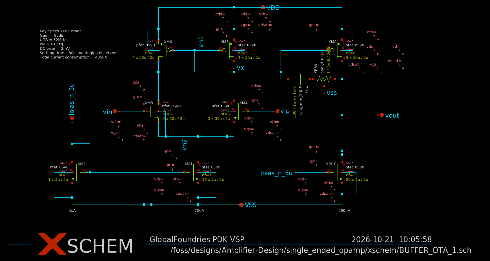
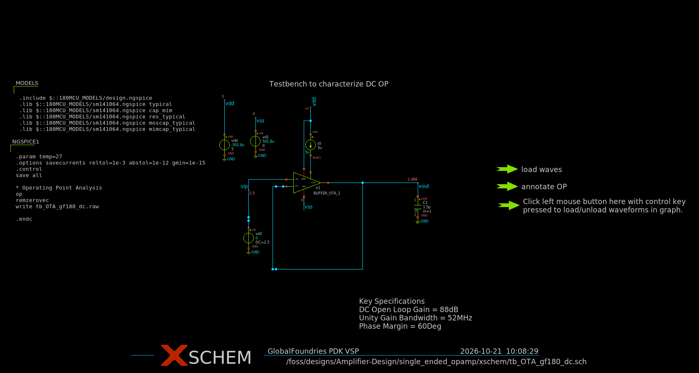
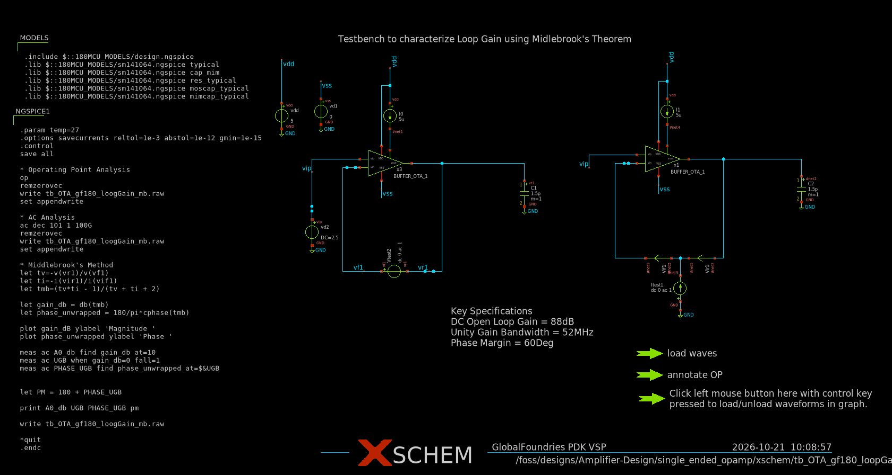

# Single-ended opamp: testbenches

Two testbenches for the single-ended OTA (`BUFFER_OTA_1`), built in Xschem and simulated with ngspice on the GF180MCU PDK.

| Testbench | What it measures | Method |
|-----------|------------------|--------|
| `tb_OTA_gf180_dc.sch` | DC operating point in unity-gain feedback | `.op` |
| `tb_OTA_gf180_loopGain_mb.sch` | Loop gain, unity-gain bandwidth, phase margin | Middlebrook (voltage + current injection) |

All schematics and symbols are in `xschem/`. Start Xschem from that folder so the symbols resolve.



## Specifications

| | Target |
|---|--------|
| DC open-loop gain | 50 dB |
| Unity-gain bandwidth | 30 MHz |
| Phase margin | 60 deg |

## Conditions

* Supplies: `vdd` = 5 V, `vss` = 0 V. Input `vip` = 2.5 V DC.
* Bias: 5 uA reference current source.
* Load (loop-gain testbench): 1.5 pF at the output.
* Models: GF180MCU `typical` (with `cap_mim`, `res_typical`, `moscap_typical`, `mimcap_typical`), 27 C.
* Simulator options: `savecurrents reltol=1e-3 abstol=1e-12 gmin=1e-15`.

## 1. DC operating point

**File:** `tb_OTA_gf180_dc.sch`



The opamp is connected as a unity-gain follower and the operating point is solved.

| Input `vin` | Output `vout` | Difference |
|-------------|---------------|------------|
| 2.5 V | 2.499 V | about 1 mV |

With a loop gain of 88.3 dB (section 2), the finite-gain error alone would be about 0.1 mV (2.5 V / (1 + 25,900)). Most of the 1 mV is therefore systematic offset, not finite gain. This does not affect the loop-gain result.

## 2. Loop gain, Middlebrook method

**File:** `tb_OTA_gf180_loopGain_mb.sch`



### Conventions

The loop is broken at the opamp's inverting input. `X` is the side that returns the signal (the output) and `Y` is the side that drives the opamp (the input). The loop gain is output side over input side, with a minus sign, so a negative-feedback loop has a positive `T` that starts at 0 degrees:

$$T = -\frac{v_X}{v_Y}$$

In this testbench the node names follow the Middlebrook convention: `vf1` is the forward side (the opamp's inverting input, `Y`) and `vr1` is the return side (the output, `X`). Phase margin is `PM = 180 deg + phase at the 0 dB crossing`.

> The fully differential CMFB testbench uses the same names the other way round, because there `vf1` is the CMFB amplifier output. Do not copy the expressions between the two testbenches without checking which node is which. See [`../fully_diff_opamp/README.md`](../fully_diff_opamp/README.md).

### Setup

The opamp is instantiated twice (`x1` and `x2`), each with its own bias source and 1.5 pF load. The two copies share only ideal sources (`vdd`, `vss`, `vip`), so voltage and current injection run in a single `.ac` analysis without interacting.

* **Main copy (`x1`), voltage injection:** `Vtest2 vf1 vr1 dc 0 ac 1` is in series between the inverting input (`vf1`) and the output (`vr1`).
* **Replica (`x2`), current injection:** `Itest1` (`dc 0 ac 1`) injects current into the node between two 0 V current probes, `Vif1` (input side) and `Vir1` (output side). Both probes point in the loop direction, from the output towards the input.
* **DC:** the loop is closed through the 0 V sources, so `.op` gives the true closed-loop bias point.
* **Analysis:** `.ac` from 1 Hz to 100 GHz, 101 points per decade.

### Loop-gain expressions

```
let tv  = -v(vr1)/v(vf1)
let ti  = -i(vir1)/i(vif1)
let tmb = (tv*ti - 1)/(tv + ti + 2)
let gain_db = db(tmb)
let phase_unwrapped = 180/pi*cphase(tmb)
```

$$T_v = -\frac{v(vr1)}{v(vf1)},\qquad T_i = -\frac{i(vir1)}{i(vif1)},\qquad T = \frac{T_v T_i - 1}{T_v + T_i + 2}$$

`Tv` is accurate while the impedance looking back into the output is small compared with the impedance of the input node, which holds at low frequency. `Ti` corrects the result near the high-frequency poles.

The control block measures `A0_db` at 10 Hz, the unity-gain frequency `UGB` (where `gain_db` falls through 0), the phase at `UGB`, and `PM = 180 + PHASE_UGB`.

### Results (typical corner)

| | Target | Result |
|---|--------|--------|
| DC loop gain (A0) | 50 dB | 88.3 dB |
| Unity-gain frequency | 30 MHz | 50.4 MHz |
| Phase at UGB | | -119.5 deg |
| Phase margin | 60 deg | 60.5 deg |

### Notes

* **Sign check:** the loop gain starts at about +88 dB with phase near 0 deg and falls from there. A flat -6 dB at 180 deg would mean the `tv` / `ti` ratios are inverted.
* **Shape:** a dominant pole near 2 kHz, then -20 dB/dec to the 0 dB crossing at about 50 MHz. The phase stays near -90 deg from about 10 kHz to 1 MHz and reaches -119.5 deg at the crossover.
* **High-frequency floor:** the gain levels out near -60 dB above 1 GHz. This is capacitive feedthrough around the amplifier, far below 0 dB, so it does not affect stability.
* **Margin:** the phase margin has only 0.5 deg of slack, and this is the typical corner only.
* **Raw file:** the `write` commands come before the `let` lines, so the raw file does not contain `tmb`. Add a final `write` after the `let` lines if you want it stored.

## How to run

1. `cd single_ended_opamp/xschem` and start `xschem`.
2. Open a testbench, press **Netlist**, then **Simulate**.
3. DC testbench: read the operating point in the ngspice console. Loop-gain testbench: the control block runs `op` and `ac`, prints `A0_db`, `UGB`, `PHASE_UGB` and `pm`, and plots magnitude and phase.
4. Raw files are written by the control block and are not committed (see `.gitignore`).

## Status and next steps

* [x] DC operating point in unity feedback
* [x] Loop gain (Middlebrook), typical corner
* [ ] Loop gain with the large L / large C method, as a cross-check
* [ ] Corners and temperature (the phase margin has only 0.5 deg of slack)
* [ ] Reach 52 MHz unity-gain frequency without losing phase margin
* [ ] Operating-point table (node voltages and device saturation margins)
